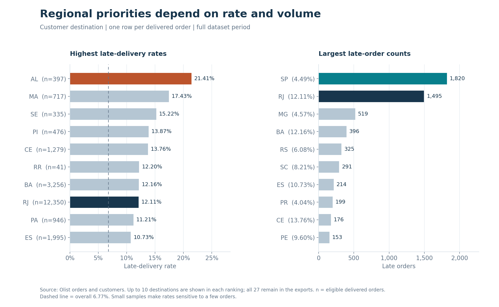

# E-Commerce Delivery Performance & Customer Experience Improvement

An operations case study using the [Olist Brazilian E-Commerce Dataset](https://www.kaggle.com/datasets/olistbr/brazilian-ecommerce) to identify delivery issues and examine their relationship with customer reviews.

**SQL / DuckDB · Python · Excel · Tableau**

[View the interactive Tableau dashboard](https://public.tableau.com/views/delivery_performance_17932155932300/DeliveryPerformanceOverview)

## Key findings

Of 96,478 delivered orders, 96,470 have usable delivery dates. Of these, **6,534 arrived late: 6.77%**. Average purchase-to-receipt duration was **12.56 days**, with a median of **10.22 days**.

- **Monthly variation:** March 2018 recorded an 18.96% late-delivery rate, the highest in the January 2017-August 2018 reporting window.
- **Regional priorities:** RJ recorded 12.11% lateness and 1,495 late orders. SP had a lower rate of 4.49% but the largest late-order count: 1,820.
- **Review timing matters:** late orders averaged 2.27/5 versus 4.29 for on-time orders. Restricting reviews to those answered on or after receipt changes the averages to 3.72 and 4.29. Causation is not established.



## Approach and recommendations

SQL classifies orders, calculates metrics, and selects one latest review per order before joining. Python validates inputs and totals, exports aggregate CSV/JSON, and generates Matplotlib figures.

An order is late when its delivery **calendar date** exceeds its estimate. Eight delivered orders without actual dates are excluded from delivery-rate denominators. Review scores 1-2 are classified as low ratings.

Investigate peak cohorts and RJ's elevated rate and volume. Review preparation and transit times, and assess how customers receive updates while waiting for overdue orders. See [business assessment and recommendations](findings/business_analysis.md) and [data quality notes](findings/data_quality_notes.md).

## Reproduce the analysis

Place the original orders, customers, and reviews CSV files in `dataset/`. From the project folder:

```bash
python3 -m venv .venv
source .venv/bin/activate
python -m pip install -r requirements.txt
python scripts/run_pipeline.py --charts
python -m unittest discover -s tests -v
```

Verified on Python 3.9.6: 16 tests and 142 aggregate checks pass. Outputs are in `data/processed/`; figures are in `assets/charts/`. Raw CSVs are excluded from Git tracking. Full instructions: [RUNNING.md](RUNNING.md).

## Scope and project status

Historical Brazilian data do not represent current Indonesian operations. Small cohorts, missing reviews, and unmeasured order characteristics limit interpretation.

The [Excel workbook](excel/delivery_analysis.xlsx) includes formula-based rates and native charts; refresh instructions are in the [Excel guide](excel/EXCEL_GUIDE.md).

The [Tableau workbook](tableau/delivery_performance.twbx) contains delivery-rate and eligible-order KPIs, a monthly trend, and a shared date filter. Its default reporting window is January 2017–August 2018: **96,203 eligible orders and a 6.79% late-delivery rate**. The full-period analysis above includes sparse 2016 cohorts, which explains the difference from 6.77%.

The [business assessment](findings/business_analysis.md) sets out investigation priorities, conditional actions, and measures of success. The dashboard is published on [Tableau Public](https://public.tableau.com/views/delivery_performance_17932155932300/DeliveryPerformanceOverview); the packaged workbook is also available in this repository.
